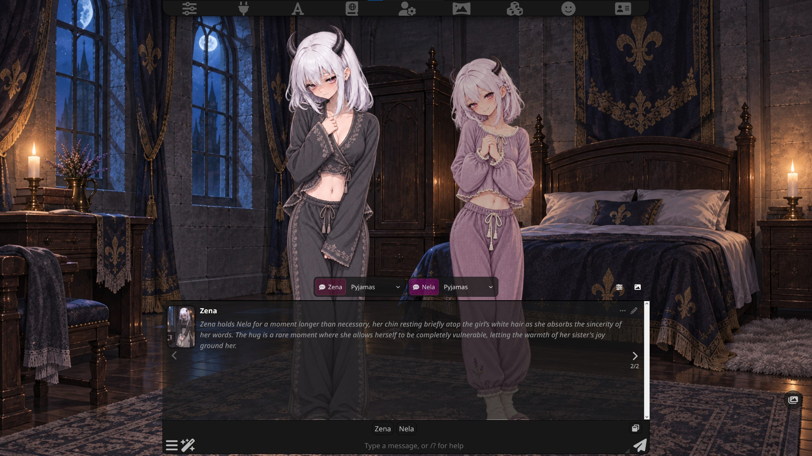
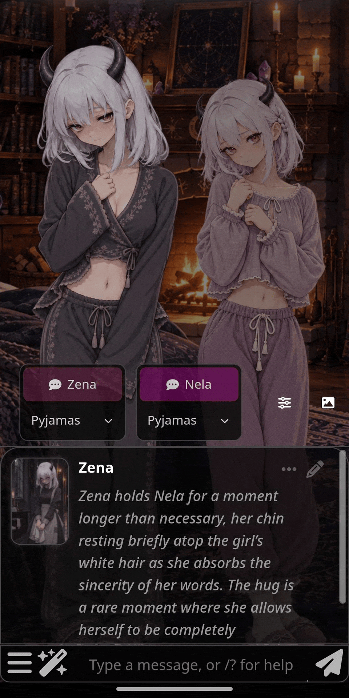
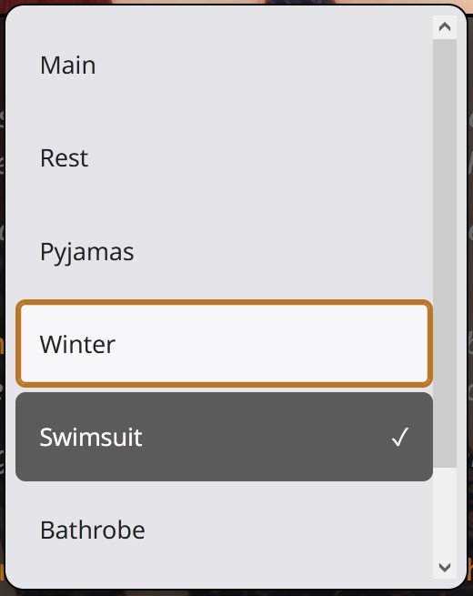
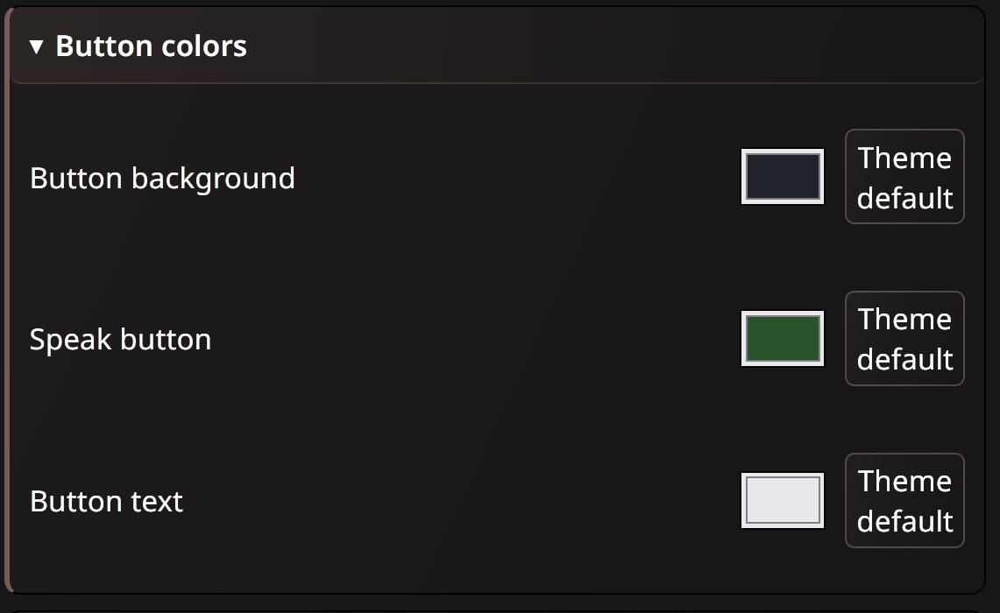
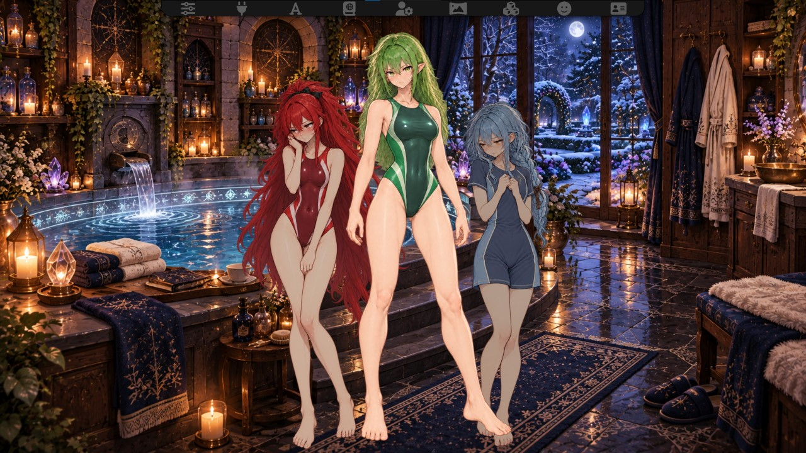
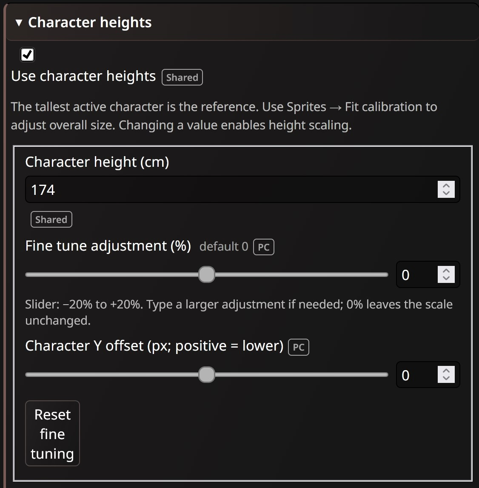
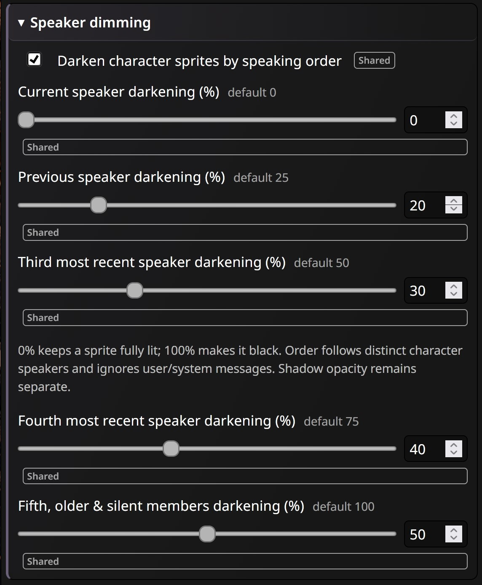
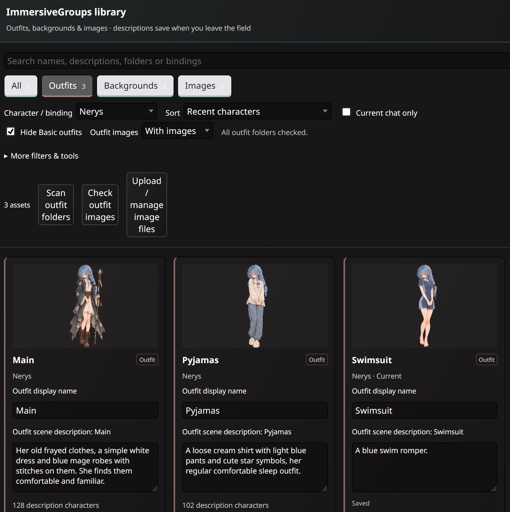

# ImmersiveGroups

A light novel style expression extension for SillyTavern, focused on group chats, multiple outfits and mobile usability. Based on Bronya Rand's **Prome-VN-Extension** and mechamarmot's **SillyTavern-LocalImage**, with an integrated asset library and optional LLM automation for outfit and background changes.

What began as a quick patch for multiple outfits in the PromeVN extension quickly became a larger overhaul, bringing group-chat improvements, outfit management, mobile layouts, backgrounds and a local image gallery together in one extension for SillyTavern.

The goal is a more cohesive light novel experience: keep a group of characters on screen, change their outfits, set the scene, and optionally let the model choose suitable outfits, backgrounds and premade gallery images.

**Current development version: 0.2.3.** Outfit/background automation works through either the main roleplay prompt or a separate API call. Gallery images have their own working prompt; coordinated image selection through the separate scene-analysis API remains planned.

> [!WARNING]
> **Beta project with limited real-world testing.** Back up your SillyTavern `data` folder before installing or updating. Use at your own risk. Features, settings and migration behavior may change during development. Automated checks do not replace testing across actual SillyTavern setups, browsers and phones.

## Preview

### PC view



### Mobile view



## Installation

1. Back up your SillyTavern `data` folder.
2. **Disable the standalone Prome and LocalImage extensions**, including separate forks of them. Keep their saved settings; do not run them alongside ImmersiveGroups.
3. Use SillyTavern's extension installer with this repository URL:

   ```text
   https://github.com/Lunarfyre-ST/ImmersiveGroups
   ```

4. Reload SillyTavern, then open **Extensions → ImmersiveGroups**.
5. Enable the character scene / VN mode. For sprite features, enable Character Expressions and set up your characters' sprite folders. Gallery rendering has its own enable setting.

For manual installation, place the extension files inside:

```text
SillyTavern/public/scripts/extensions/third-party/ImmersiveGroups/
```

`manifest.json` must be directly inside that folder, without another nested `ImmersiveGroups` folder. No separate Gallery extension or Node/npm installation is needed to use the extension.

When updating manually, replace the matching extension files and reload SillyTavern. Check [Releases](https://github.com/Lunarfyre-ST/ImmersiveGroups/releases) for version notes and available checkpoints.

### Migrating existing settings

On first startup, settings from `Prome-VN-Extension` and `SillyTavern-LocalImage` are copied into ImmersiveGroups. The original settings are retained as backups, and subsequent startups do not overwrite your newer ImmersiveGroups preferences with them. Existing image assignments, outfit data and supported preferences are carried over.

If an old extension copy remains enabled, a conflict message blocks startup to prevent duplicate handlers. Disable the conflicting copy and reload. Chat files are not part of the settings migration.

## Features

Built on Prome-VN's visual novel foundation, ImmersiveGroups adds the following fixes and controls, with a focus on group chats, multiple outfits and mobile usability.

### Outfits and group chats

- **Multiple-outfit fixes:** addresses outfit handling issues while Prome's visual novel interface is active, including in group chats.
- **Group-chat message controls:** per-character Speak buttons request the next reply from a particular character. These can submit your current draft text when triggering a reply.
- **Outfit selection:** change clothes through each character's outfit selector, with distinct hover/focus outlines, a selected checkmark and mouse, touch and keyboard support. Hover and scroll to cycle through outfits.

  

- **Smooth outfit changes:** selector-based changes preload the image and update that character in place. Existing Quick Reply outfit changes can still trigger native sprite reloads.
- **Outfit management:** find common folders, remember outfits used through Quick Replies, scan a selected local character directory or add folders manually. Rename, hide, reorder and describe outfits without renaming their files.
- **Sprite ZIP uploads:** import images directly into an outfit folder. Existing filenames are preserved by numbering duplicates, such as `neutral-1` becoming `neutral-2`.
- **Character styling:** customize character button backgrounds, Speak button colors and text colors, plus per-outfit text colors. Separated selectors retain their character colors.

  

- **Working automation locks:** locked characters are omitted from model outfit context and automatic changes are rejected. Manual outfit selection remains available.
- **Muted-member handling:** muted group members disappear on desktop and mobile, and the remaining sprites readjust.

### Sprite customization

- **Character heights in centimeters:** scale characters relative to the tallest active member, with individual fine tuning to compensate for inconsistent sprite framing.

  

  

- **Fit calibration:** adjust the overall sprite scale until the tallest character fits comfortably on screen.
- **Persistent profiles:** heights are remembered across chats and groups. Heights are shared between PC and mobile; fine tuning, fit calibration and visual offsets have separate profiles.
- **Shadow opacity:** control how strong sprite shadows appear.
- **Speaking-order dimming:** configure darkness for the current, previous and older speakers, including completely black silhouettes.

  

- **Sprite overlap:** prioritize brighter characters, then recent speakers, so dimmed sprites stay behind highlighted ones.
- **Sprite spacing and offsets:** bring characters closer together or spread them out, with global and per-character vertical positioning.

### Mobile and interface controls

- **Multiple sprites on mobile:** display several active group members together on smaller screens.
- **Separate PC/mobile profiles:** independently tune control sizes, placement, sprite spacing and visual scaling.
- **Automatic or forced layout:** use viewport-width detection or force PC/Mobile to preview either layout.
- **Live Scene tuning:** adjust layout, Sheld height, spacing, fit, controls and offsets while viewing the chat. The tuning panel stays in place while the scene moves.
- **Adjustable Sheld size:** resize the chat window to balance text and sprite visibility.
- **Limitable, scrollable Quick Reply rows:** cap inline Quick Replies and scroll additional rows. Set rows to zero to hide the inline bar; the popup remains available.
- **Flexible character controls:** show or hide buttons, place controls above chat or below the textbox, put names above selectors, center controls, and adjust sizes and idle opacity. Speak/outfit controls stay paired when both are below the textbox.
- **Automatic row fitting:** distribute available width across 1–8 character boxes per row, including compact mobile rows.
- **Name/Speak customization:** separate width, height and text size, plus optional name abbreviations.
- **Visual presets:** save named layouts and import/export PC/mobile visual settings and character corrections.
- **Organized settings:** wrapping tabs with subtle accent colors and expandable advanced options. Original Prome settings remain in their own tab.

### Unified asset library

- **One library:** browse outfits, backgrounds and gallery images together or use their individual tabs.

  

- **Shared search:** search names, descriptions, folders, galleries and character bindings.
- **Filtering:** narrow results by character, current chat, descriptions, outfit visibility, linked/starred backgrounds or image gallery. Hide Basic outfits and filter outfits with or without images.
- **Sorting:** sort by name, asset type, character/gallery, missing descriptions or description length. Character activity/recent sorting uses available SillyTavern metadata, with current-chat fallbacks; activity is not an exact global message count.
- **Visible descriptions:** edit scene descriptions directly under each entry. Edits save when leaving the field or closing the library.
- **Character and group bindings:** make images follow one or more characters into group chats, or bind them to specific groups. Optional all-required matching is available.
- **Existing-image aliases:** renaming an image command retains the previous name as an alias for older messages.

### Images and backgrounds

- **Integrated Gallery:** local image handling based on SillyTavern-LocalImage, including a shared General gallery.
- **Optional image prompt:** give the roleplay model exact image commands, descriptions and availability rules without making a separate API call.
- **Optional loading limits:** image cooldowns and per-message/per-round caps. Suppressed commands leave a blank instead of visible command text.
- **Image sizing and formatting:** adjustable maximum image height, proportional width fitting and formatting-preserving rendering, including images between paragraphs and across swipes.
- **Quick Image Send:** search and insert image commands from the shared Backgrounds / Send image menu. Send an image-only message when the draft is empty, or insert a command into your draft.
- **Background organization:** star favorites, bind locations to characters and save scene descriptions. The compact scene menu separates linked and starred backgrounds.
- **Linked-background arrows:** optional previous/next buttons beside Scene tuning cycle through backgrounds linked to every active character, without a filename bar.
- **Optional chat-load backgrounds:** restore a remembered choice or apply character/group defaults, with adjustable delay, ordered rules and respect for native background locks.

### Scene automation and context

- **Prompt mode:** inject outfit/background catalogs and descriptions into the main roleplay request. The model writes applicable scene commands with its reply, avoiding a separate analysis call.
- **API mode:** analyze the latest reply through the current main API, another connection profile or a custom/local OpenAI-compatible endpoint. Manual testing and optional automatic analysis are available.
- **Character scope:** include all active, unlocked characters for group-wide outfit changes, or only the speaking character to reduce outfit context and restrict its targets.
- **Shared background context:** by default, offer only backgrounds linked to every active character. This stays group-wide even when outfit context is speaker-only, with no fallback to unlinked backgrounds.
- **Prompt controls:** configurable injection depth, editable instructions, catalog limits, preview and token count. A character estimate is shown if tokenizer counting is unavailable.
- **Command placement:** independent Before, After or Automatic placement choices for scene commands and Gallery image commands.
- **API history:** choose how many recent user/assistant messages to send. The default is one; the slider covers 1–5, with larger typed values supported.
- **Validation and cancellation:** check targets, availability and locks before applying changes. Changed chats/messages invalidate pending results; reported truncated responses do not apply changes.

Automation is optional and depends on the model following the supplied instructions. Gallery image prompting is independent of outfit/background automation. The separate scene-analysis API currently handles outfits and backgrounds only.

## Quick start

### Tune while viewing the chat

Click the **sliders icon beside the character controls** to open **Scene tuning**. These controls adjust the **live profile**, even if the main settings editor is showing the other profile. Sheld height applies to both layouts.

In the main settings, **Preview layout** chooses the live layout; **Settings profile** chooses which saved profile you edit. **Follow active layout** follows the current PC/mobile mode. PC/Mobile badges mark profile-specific fields; Shared settings apply to both.

**Automatic uses viewport width**, selecting Mobile at **1000 CSS pixels or less** by default. Change the threshold under **Layout → Mobile layout**. Opening the phone keyboard does not switch profiles based on height. Forcing a layout changes ImmersiveGroups behavior, not SillyTavern's entire responsive interface.

For compact rows, try **Scene tuning → Buttons → Fit character boxes to row**, choose the number of boxes, and enable names above selectors. The main settings expose these controls under **Controls → Fit & name sizes**.

### Set character heights

In **Characters**, select a character and enable height scaling, then enter their height in centimeters. In **Sprites**, adjust **Fit calibration** until the tallest active character fits, then use individual **Fine tune** sliders as needed. With equal fine tuning, a 150 cm character uses 75% of a 200 cm character's sprite height. Different transparent padding or artwork framing may still need adjustment.

Fine tuning and Fit calibration use signed adjustments: **0% means unchanged**, +10% means a 110% multiplier. Their sliders cover −20% to +20%; number fields accept larger adjustments. Earlier values are retained through migrations. Visual correction resets keep the character's height in centimeters.

### Manage outfits and assets

Open **Gallery → Open asset library**, or use **Manage outfits / Manage backgrounds** to open the same window on the relevant tab. Descriptions are directly editable under each entry.

In **All / Outfits**, use **Scan outfit folders** on the toolbar and choose your local SillyTavern `characters` folder or one character folder. Matching folders containing images are verified against the server and imported. The scan reads names only; it does not upload files. A directory picker is needed because the native sprite API cannot list arbitrary subfolders.

Use **Hide Basic outfits** and **Outfit images** to tidy the library. The image filter checks sprite lists; failed checks are not treated as empty folders. **Check outfit images** retries stale or failed results. These library filters do not change which outfits are available in character selectors or model context.

Each outfit has an **Upload sprite ZIP** button. Supported images include PNG, JPG/JPEG, GIF, WebP, AVIF and BMP. Imports preserve existing filenames by adding numbered variants. SillyTavern's native expression cache may need a page reload to discover newly added expressions in an already-cached folder.

### Use gallery images

Use **Upload / manage image files** in the asset library to upload or assign images. A General gallery command looks like:

```text
::img general image-name::
```

Image names contain no spaces or colons. Add descriptions and bindings, then optionally enable **Automation → Enable image instructions and the available-image list**. Its placement selector controls whether the model puts images before, after or within the narration.

**Image prompts and loading limits are off by default on a fresh setup.** Migrated preferences retain their saved values. A round means one user message plus all following character replies. With a cooldown of three rounds, an image shown in round 1 can return in round 5.

See [Gallery documentation](docs/GALLERY.md) for more detail.

### Enable outfit and background automation

1. Add useful outfit and background descriptions in the asset library. Link shared backgrounds to **every active character** who should use them.
2. Open **Automation**, enable model outfit/background commands and choose which changes are allowed. Background changes have their own switch.
3. Choose **All active, unlocked characters** or **Speaking character only** for outfit context.
4. Start with **Prompt mode** and inspect **Preview context & token count**. Injection depth defaults to 1; depth 0 is nearest the reply.
5. Generate a new reply. For API mode, configure a destination and use **Analyze & apply last reply** to test it; enable **Automatically analyze new replies** when ready.

Scene commands use exact IDs and folder names from the supplied catalog:

```text
::outfit "character-avatar.png" "Character/swimsuit"::
::background "estate-bath.png"::
```

Scene commands must be on separate lines. They can appear before, between paragraphs or after the roleplay, following the placement setting. Displayed command text is hidden by default while the original message retains it.

Automatic API analysis runs once after a solo reply or a completed group round, once roleplay generation is idle. It uses the final assistant reply and your chosen recent-message window, not the entire chat by default. API keys for custom endpoints stay in page-session memory. Custom endpoints must be reachable from the browser and allow its origin.

Outfit locks and model background locks block automatic changes while leaving manual selection available. Loading a chat or choosing an existing swipe does not replay historical scene commands. A new generated swipe is a fresh reply and can trigger automation.

## Progress and planned features

**Available now:** outfit/background Prompt mode, manual and automatic API analysis, all-character/speaker-only outfit scopes, working locks, background descriptions and linked context, a unified asset library, and independent Gallery image prompting.

**Still planned:**

- A movable entry in SillyTavern's **Chat Completions Prompt Manager**. Current scene injection uses the extension-prompt hook with its own depth and preview controls.
- Coordinated Gallery image selection through the separate scene-analysis API, alongside outfit and background decisions.
- Continued improvements to mobile usability, settings organization, group-chat compatibility and real-model reliability.

All-character context supports multiple outfit changes and provides a larger, more stable catalog. Speaker-only context uses fewer outfit tokens and changes with each speaker. Actual caching, speed, cost and command reliability depend on the model and provider.

## Development

<details>
<summary>Build and validation commands</summary>

Node/npm is only required for development. The repository includes the ready-to-use Gallery bundle and vendored sprite ZIP reader.

```sh
npm ci
npm run build
npm run check
npm test
```

When editing Gallery source, rebuild and commit the generated bundle and dependency notices as well.

Optional browser integration checks:

```sh
npx playwright install chromium
npm run test:browser
```

Version 0.2.3 has 46 unit tests and browser regression coverage for settings migration, height calculations, image/swipe rendering, library filters, folder scanning, duplicate-safe uploads, command parsing, scopes, locks, API scheduling and cancellation. Browser checks use synthetic chat data and simulated SillyTavern/model APIs. Real-device and provider compatibility still need testing.

</details>

## Credits and origins

ImmersiveGroups is a modified project built on the work of:

- **[Bronya Rand — Prome-VN-Extension](https://github.com/Bronya-Rand/Prome-VN-Extension):** the foundation for the visual novel interface, sprite presentation and visual customization. The original UI also credits **Prometheus**.
- **[mechamarmot — SillyTavern-LocalImage](https://github.com/mechamarmot/SillyTavern-LocalImage):** the foundation for local image handling and gallery functionality.

Much of the underlying functionality comes from these original extensions. Credit for that work belongs to their authors and contributors; ImmersiveGroups adds the integration, modifications and new features described above. This project is independently maintained and is not an official release of either original extension.

Thanks also to the [SillyTavern](https://github.com/SillyTavern/SillyTavern) project and its contributors. Sprite ZIP imports use **JSZip** by Stuart Knightley and contributors. See [CREDITS.md](CREDITS.md) for additional attribution and dependency notices.

## License

ImmersiveGroups is distributed under the GNU Affero General Public License v3.0; see [LICENSE](LICENSE). Original copyright notices, attribution and applicable upstream license notices are retained with the corresponding source code. Upstream and dependency license files are included in [licenses/](licenses/).
