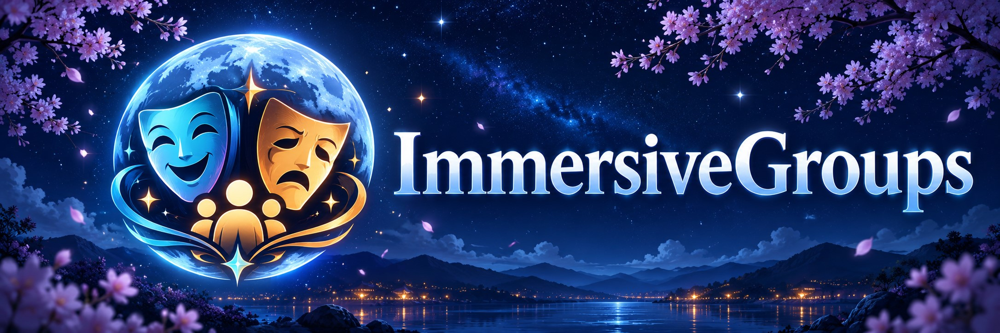

# 🎭 ImmersiveGroups

ImmersiveGroups is a SillyTavern extension for giving your chats a visual novel feel. Keep several characters on screen, give them different outfits, change the background, and add images to the conversation. It works with solo and group chats, on PC and mobile.

Started as a modification of PromeVN. [See credits below](#credits-and-origins).

You can change outfits and backgrounds yourself, or let the model choose them as the story moves along. There are also plenty of ways to adjust how the scene looks: character heights, sprite spacing, button colors, transitions and separate PC/mobile layouts.

**Current version: 0.3.8** — mobile library scrolling, recent-speaker scenes, shared-height fixes and scene commands during streaming. [Release notes](docs/RELEASE_0.3.8.md).

[Previews](#-previews) · [Install](#-install) · [First steps](#-start-with-a-chat) · [Import / export](#-import-and-export) · [Automation](#-let-the-model-change-the-scene) · [Credits](#credits-and-origins)

> [!WARNING]
> **Still in beta.** Back up your SillyTavern `data` folder before installing or updating. The extension has automated tests, but testing with real setups is still limited. Expect some rough edges, especially with larger collections and different browsers or phones.

## 🖼️ Previews

### 🖥️ PC


### 📱 Mobile


## ✨ Is it useful for your setup?

The more sprites and outfits you use, the more there is to work with. You don't need to use every feature, though.

| Your setup | Things you might use |
| --- | --- |
| One character, one outfit | VN mode, sprite sizing, colors, backgrounds and gallery images. |
| One character, several outfits | Outfit switching, the outfit library and optional automatic changes. |
| Several characters | Multiple sprites, per-character Speak buttons, relative heights and mobile layouts. |
| Several characters with several outfits | All of the above, plus shared outfit changes and backgrounds that change the group's clothes. |

You'll need your own sprites, backgrounds or images. This extension doesn't generate them. There is some setup involved, and the settings menu is fairly large. Start with the parts you want; automation is optional and starts off on a fresh install.

📚 **Looking for a starting point?** The [ImmersiveGroups Library](https://github.com/Lunarfyre-ST/ImmersiveGroups-Library) is a home for premade character sets with cards, expression sprites, outfits and backgrounds. It's there to help you try the extension without putting together every asset yourself, or to give you a base for your own setup.

---

## 📥 Install

1. Back up your SillyTavern `data` folder.
2. **Disable standalone Prome and LocalImage extensions**, including forks. Keep their saved settings, but don't run them alongside ImmersiveGroups.
3. Open SillyTavern's extension installer and paste:

   ```text
   https://github.com/Lunarfyre-ST/ImmersiveGroups
   ```

4. Reload SillyTavern and open **Extensions → ImmersiveGroups**.
5. Enable **character scene / VN mode**. For sprites, also enable SillyTavern's Character Expressions and set up your characters' sprite folders. Gallery images have their own enable setting.

If you're coming from Prome or LocalImage, supported settings are copied over on the first startup. The originals are kept as backups. Later startups won't replace your ImmersiveGroups settings with the old ones, and the migration doesn't change your chats.

If startup is blocked by an extension conflict, check for another enabled copy of Prome or LocalImage, disable it, and reload.

## 💬 Start with a chat

Open a character or group chat with sprites, then try the outfit selectors beside the character controls. **Speak** asks a particular character to reply; it can also submit any text you've already typed into the message box.

> [!TIP]
> The **sliders icon** opens **Scene tuning**, so you can adjust the layout while looking at the chat. Start by getting the sprites to fit, then adjust spacing and the chat window height. You can return to the main settings for the less frequently used options.

PC and mobile have separate layout settings. **Preview layout** lets you try either one, and **Settings profile** chooses which one you're editing. Leave it on **Follow active layout** if you want to edit the layout you're currently seeing. Scene tuning always edits the live layout. Settings marked **Shared** apply to both.

By default, a viewport width of 1000 CSS pixels or less uses the mobile layout. You can change that under **Layout → Mobile layout**. Forcing PC or Mobile changes this extension's layout; it doesn't force the rest of SillyTavern into that mode.

---

## 👗 Outfits and character controls

Change each character's outfit from their selector. You can use the mouse, touch or keyboard, or hover over the selector and scroll through outfits. Outfit changes load the new sprite before switching it in place.


Open **Manage outfits**, or **Gallery → Open asset library**, to add and organize outfits. You can rename their display labels, hide them from selectors, reorder them, and write descriptions without renaming the files on disk. Preview arrows and the expression dropdown let you browse sprites without changing what the character is wearing in the chat.

- ➕ **Add outfit** accepts a folder name or full path, with an optional sprite ZIP. Choose the character in the form itself.
- 🔍 **Scan outfit folders** reads outfit names from your local `characters` folder. It doesn't upload images. If SillyTavern runs on another device, those folders also need to exist on that server; otherwise, upload a ZIP instead.
- 📦 **Upload sprite ZIP** adds images to an outfit. Duplicate filenames get numbered variants so the existing files are kept. You may need to reload SillyTavern to see newly added expressions.
- ↕️ **Reorder outfits** switches the library to compact rows with up/down arrows. Choose **Done reordering** to return to the previews.

Outfit locks prevent automatic clothing changes while still letting you choose outfits manually. Muted group members are hidden from the scene, and the remaining sprites adjust to the available space.

You can also change each character's button background, Speak button color and text color, including different text colors for individual outfits.


<details>
<summary><strong>👥 Shared outfits and folders under the wrong character</strong></summary>

Give matching outfits the same **Shared outfit name**, such as `winter` or `pyjama`. With **All characters outfit selector** enabled under **Controls** or **Scene tuning → Buttons**, you can change the whole active group at once. It only offers names with one clear match for every active character.

If an automatically learned folder appears to belong to another character, the extension sets the entry aside and keeps its description. Check **Library → Tools → Mismatched outfits set aside**. Use **Restore as shared outfit** when the shared folder is intentional, or discard the entry to remove it from the library. Neither action deletes its sprite files. You can also add an intentionally shared folder through **Add outfit**.

Automatic common-folder discovery and automatic Basic hiding start off on fresh installs. The library's **Filters** can hide Basic outfits or show outfits with/without images without changing the outfits available in chat or automation. **Tools → Check outfit images** retries unavailable image checks.

</details>

## 📐 Make the scene fit

Set character heights in **Characters**, then use **Sprites → Fit calibration** to get the tallest active character to fit on screen. The others scale relative to that character. Unset heights use 165 cm.


In **Characters → Character heights**, set **Recent speakers displayed** to 2 or 3 for a smaller mobile cast, or 0 for everyone. Choose whether calibration follows the tallest displayed character or stays at the tallest member of the whole group, including muted characters. These two preferences are separate for PC/mobile.

Sprite artwork isn't always framed consistently, so use **Fine tune** if someone still looks too large or small. Heights are shared across PC and mobile, while fine tuning, fit and visual offsets have separate profiles. If old fine-tune values keep appearing, **Reset all character fine tuning (PC + mobile)** clears them across both profiles without resetting your heights. An outfit can also have its own height override; leave it blank to use the character's normal height.


There are controls for sprite spacing, shadows, vertical offsets and dimming previous speakers. Brighter characters and recent speakers can appear in front of the others. You can also move or resize character controls, put names above outfit selectors, and fit several character boxes into each row.


For the chat itself, adjust **chat window / Sheld height** and choose whether to show scrollable history or only the latest message. Quick Reply rows can be limited and scrolled; setting the row count to zero hides the inline bar while keeping the popup available.

### 🎞️ Add transitions

Open **Animations**, or **Scene tuning → Animations**, and enable outfit or background fades. **Crossfade** blends the old image into the new one. **Fade out, then fade in** shows them one after the other.

Fade-in and fade-out timings start linked; unlink them if you want different durations. Controls show seconds: sliders move in 0.1-second steps, and you can type a fraction for an exact value. Fades start off on a fresh install. **Reset animation defaults** turns them off again and restores Crossfade with 0.2-second outfit timings and 0.35-second background timings. These settings are shared between PC and mobile, and reduced-motion preferences are respected.

### Try the new motion options

The **Animations** tab and **Scene tuning → Animations** put **Idle breathing** and **Idle background movement** first. Open **Experimental** for entrances/exits, speaking emphasis, expression blends, manual reactions, a scene fade through black and smoother speaker focus.

Each effect starts **off**. Try its small **Preview** first, then enable it in the scene and adjust timing and strength. Breathing can follow the speaker or all visible characters. With all characters enabled, lower **Waiting-character intensity** for a subtler effect on everyone else; 100% keeps it equal and 0% stops their breathing. For reactions, choose a character and play a hop, nod, tilt or shake yourself. Smooth focus uses the existing sprite-dimming settings.

These effects leave your saved heights and fine tuning alone. Reduced-motion preferences are respected, and motion stops when VN mode is off or the page is hidden. **Reset animation defaults** turns the new effects off again.

For phones, enable **Idle background movement → Full-height vertical background pan on mobile**. It moves through the available crop with a gentle drift; increase the one-way duration for slower movement. Desktop keeps its regular pan.

## 🗂️ Backgrounds, images and the library

The asset library brings outfits, backgrounds, gallery images and named character groups into one window. Search names or descriptions, filter by character/group, and edit descriptions directly under each entry.


Use the background/image picker for quick changes without opening the full library. It has thumbnail and list views, search, and separate **Backgrounds** and **Send image** tabs. Quick Image Send can send an image-only message or put an image command into the draft you're writing.

For backgrounds, you can star favorites, link locations to characters or groups, and save scene descriptions. Optional arrow buttons cycle through backgrounds that fit the active characters. You can also set a remembered or default background to load when opening a chat.

### 🔗 Change outfits with a background

For example, you might want a bedroom background to put everyone in their pyjamas:

1. Give each matching outfit the shared name `pyjama`.
2. On the background card, choose `pyjama` as its **Linked outfit name**.
3. Enable **Backgrounds → Apply outfits linked to backgrounds**.

Choosing that background can now change matching unlocked characters too. It works with manual choices, chat-load backgrounds and model commands. Missing or ambiguous outfits are skipped. If the model gives an explicit outfit command as well, that takes priority.

**Library → Groups → Add group** lets you save a named set of characters for background and image links. Every saved member must be present for the group to match; extra chat members are allowed. These are reusable presets, separate from SillyTavern group chats.

If a background file has been moved or renamed, use **Tools → Review missing backgrounds** to remove the old entry or relink it to the new file. Relinking keeps descriptions, favorites and links; these tools don't delete image files.

### 🖼️ Put gallery images in messages

Use **Upload / manage image files** in the library to upload images and give them command names. A General gallery image uses:

```text
::img general image-name::
```

Image command names can't contain spaces or colons. You can type the command yourself, use Quick Image Send, or enable the model's image instructions under **Automation**. Renaming an image command keeps the old name as an alias for existing messages.

Image sizing, cooldowns and per-message/per-round limits are adjustable. Image instructions and loading limits start off on fresh installs. See the [Gallery guide](docs/GALLERY.md) for the details.

---

## 📦 Import and export

Open **Import / export** from the library toolbar or extension settings to move characters and their setup between installations.

1. Choose the characters, name the pack and set its version, for example `1.0.0`.
2. Choose what to include: outfits, descriptions, heights, colors, backgrounds, groups, gallery data or preferences. Expand the outfit count to toggle individual **character / outfit** entries. Backgrounds have their own checklist.
3. Decide which files to include. **Sprite images start enabled**; character cards, background images and gallery files are separate choices. Cards can be PNG (portrait and data) or JSON (data only).
4. Download the ZIP. On the other installation, open **Import**, choose the ZIP, and map the source characters to the characters you want to use. If cards were included, you can choose to create new characters instead.
5. Check the destination folders and import preview. Existing outfits start unchecked. Select the ones you want to update, read their conflict notices and differences, and acknowledge the warning before applying.

Identical sprites with the same filename are kept without uploading again. A newer pack version helps identify an update, but never gives permission to overwrite files. Reuse the same bundle name on the exporting installation to keep its pack identity for later revisions.

Existing character cards aren't replaced. Unrelated entries are kept, and imported gallery files get new filenames. Chats, credentials and API connection details aren't included. Imported automation stays off until you turn it back on.

Back up before updating a pack: if an upload fails, files already written can remain even though the extension settings weren't applied. The [transfer guide](docs/TRANSFERS.md) explains the available choices, limits and recovery steps.

## 🤖 Let the model change the scene

Automation is optional. You can use all the manual controls without turning it on.

First, give outfits and backgrounds useful descriptions in the library. Link shared backgrounds to every active character, or to a named group whose members are all present. This tells the model which locations it can choose for the current chat.

Under **Automation**, enable **scene context / automation** and choose which changes you want to allow. Start with **Prompt mode**: outfit and background information is added to your normal roleplay request, and the model can include scene commands in its reply. **Preview context & token count** shows what will be sent.

You can offer outfits for all active unlocked characters, or only the speaking character. Gallery image instructions have their own switch. Outfit/background commands look like this:

```text
::outfit "character-avatar.png" "Character/swimsuit"::
::background "estate-bath.png"::
```

Commands need their own lines and must use the exact names supplied to the model. They can go before, between or after the narration. The displayed command text is hidden by default, while the original message keeps it. Opening a chat or selecting an old swipe doesn't replay old scene commands.

Complete command lines now apply while a reply streams; partial commands wait. A command at the very end without a newline applies when the reply finishes. Manual outfit selectors also work during generation. Stopping a reply cancels pending changes but keeps changes that already happened. API analysis still waits until generation finishes.

### 📝 Scene descriptions without automatic changes

Choose **Prompt mode** and enable **Descriptions only — no automation commands** to give the model current outfit, background and matching group descriptions as reference. This can include locked characters. Turn off Gallery image instructions separately if you don't want image commands either.

### 🔌 Separate API analysis

**API mode** makes a separate request to read the latest reply and decide whether outfits or the background should change. It can use your main API, another connection profile, or a custom/local OpenAI-compatible endpoint. It currently handles outfits and backgrounds, not gallery images.

Test it with **Analyze & apply last reply** before enabling automatic analysis. Automatic analysis waits for the solo reply or group round to finish. It sends the latest assistant reply and your chosen recent-message window; it doesn't send the whole chat by default.

> [!WARNING]
> A separate analysis request can affect prompt caching and increase API costs. Try a local, free or low-cost option first, and check the actual requests and charges before leaving automatic analysis on.

Custom endpoints must be reachable from the browser and allow requests from it. Custom API keys stay in memory for the current page session. Outfit locks and background locks prevent automatic changes while leaving manual choices available. Results from a chat or message you've since changed are discarded.

---

## 🛠️ What's next?

For 0.3.8, try the mobile library, recent-speaker limits and streaming commands with your own sprites and devices. Optional LunarDebug recordings can help investigate anything unexpected. Testing real packs on a clean installation is still a priority too: fresh imports, repeat imports, deliberate conflicts and larger collections. The [0.3.5 review and test checklist](docs/IMPORT_EXPORT_REVIEW_0.3.5.md) records what's been checked and what still needs testing.

As these tests settle, I may start inviting more users. I also want to improve the menus and mobile controls and write a separate guide with more images. More animation options and ways to reduce the context needed for automation are also on the list.

If you report a problem, include your SillyTavern and extension versions, browser/device, what you tried and what happened. Please leave API keys and private chat content out of reports.

## 🧰 Development

See [Development and validation](docs/DEVELOPMENT.md) for local checks, browser tests and the release checklist. Coding-agent guidance is in [AGENTS.md](AGENTS.md).

---

## Credits and origins

ImmersiveGroups is maintained by **[Lunarfyre-ST](https://github.com/Lunarfyre-ST)**. Project repository: **[Lunarfyre-ST/ImmersiveGroups](https://github.com/Lunarfyre-ST/ImmersiveGroups)**.

It is a modified project built on the work of:

- **[Bronya Rand — Prome-VN-Extension](https://github.com/Bronya-Rand/Prome-VN-Extension):** the foundation for the visual novel interface, sprite presentation and visual customization. The original UI also credits **Prometheus**.
- **[mechamarmot — SillyTavern-LocalImage](https://github.com/mechamarmot/SillyTavern-LocalImage):** the foundation for local image handling and gallery functionality.

Much of the underlying functionality comes from these original extensions. Credit for that work belongs to their authors and contributors; ImmersiveGroups adds the integration, modifications and new features described above. This project is independently maintained and is not an official release of either original extension.

Thanks also to the [SillyTavern](https://github.com/SillyTavern/SillyTavern) project and its contributors. Sprite ZIP imports use JSZip by Stuart Knightley and contributors. See [CREDITS.md](CREDITS.md) for additional attribution and dependency notices.

## License

ImmersiveGroups is distributed under the GNU Affero General Public License v3.0; see [LICENSE](LICENSE). Original copyright notices, attribution and applicable upstream license notices are retained with the corresponding source code. Upstream and dependency license files are included in [licenses/](licenses/).
